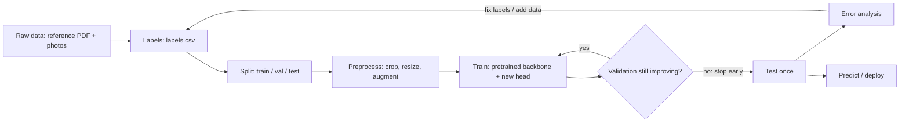

# 01 · Getting started: Python and machine learning for a C#/.NET developer

This guide assumes you write production code for a living and have never used Python's data
science stack. It explains *why* things are done a certain way, maps Python concepts to their
.NET equivalents, walks through how a model is trained end to end, and ends with a step-by-step
recipe for turning the 100-page reference document and your example photos into a labelled
training set.

**Suggested path through this repo (first day):**

1. Install the tools: [02_INSTALLATION.md](02_INSTALLATION.md) (about 30–45 minutes, mostly downloads).
2. Read sections 1–4 below (Python through .NET eyes, the libraries).
3. Do the ten-minute tour in section 5: run the tests, run Project 2 on the samples, open a notebook.
4. Read section 6 (how training works), then follow section 7 with your real data.

---

## 1. Python through .NET eyes

### Concept map

| You know (.NET) | Here (Python) | Notes |
|-----------------|---------------|-------|
| Solution (`.sln`) | The repository root | Holds several projects |
| Project file (`.csproj`) | `pyproject.toml` | One per package: `projects/*/pyproject.toml` |
| NuGet / nuget.org | pip / PyPI (pypi.org) | `python -m pip install <package>` |
| `<PackageReference Version=…>` | `requirements/*.txt` | Exact pins like `numpy==2.5.3` |
| `packages.lock.json` | `requirements/lock.txt` | Every indirect dependency pinned too |
| SDK selection (`global.json`) + restored packages | **Virtual environment** `.venv\` | A private copy of the interpreter plus its own package folder, per repo |
| `dotnet` CLI | `py`, `python -m pip`, `python -m venv` | `py` is the Windows launcher/installer |
| `<ProjectReference>` | Editable install (`pip install -e`) | Code edits take effect without reinstalling |
| `Program.Main` | `if __name__ == "__main__":` / `[project.scripts]` | The latter creates `ribbon.exe` and `layer-diff.exe` in `.venv\Scripts` |
| `namespace` + `using` | package (folder with `__init__.py`) + `import` | `from layer_diff.compare import compare_pages` |
| xUnit / NUnit + Test Explorer | pytest + VS Code Testing panel | Tests are plain functions using `assert` |
| Roslyn analyzers + `dotnet format` | ruff | `ruff check .` and `ruff format .` |
| `appsettings.json` | `configs/*.yaml` | Loaded into typed dataclasses |
| System.CommandLine | argparse (standard library) | See each project's `cli.py` |
| `record` | `@dataclass` | Used throughout for results and settings |
| `using (var x = …)` | `with … as x:` | Deterministic cleanup (files, PDFs) |
| LINQ `Where`/`Select` | Comprehensions | `[f(x) for x in items if x.ok]` |
| `IEnumerable` + `yield` | Generators + `yield` | Same idea, same keyword |
| Nullable reference types | `str \| None` type hints | Checked by the editor (Pylance), **not** enforced at run time |
| LINQPad / Polyglot Notebooks | Jupyter notebooks (`.ipynb`) | Run code in cells, see charts inline |

### Differences that bite C# developers

* **Indentation is syntax.** Blocks are defined by indentation, not braces. Use 4 spaces (the
  editor and ruff handle it).
* **Type hints are documentation plus editor checks**, not a compiler. `def f(x: int)` happily
  accepts a string at run time. There is no build step to catch mistakes, which is why this repo
  leans on tests (`pytest`) and the linter (`ruff`).
* **Numbers:** `/` always returns a float (`7 / 2 == 3.5`); `//` is integer division.
* **Everything is a reference.** Slicing a NumPy array returns a *view*: writing into
  `image[0:10, 0:10]` changes `image`. Call `.copy()` when you need a copy.
* **Mutable default arguments are shared** between calls. Write
  `def f(items: list | None = None)`, never `def f(items=[])`.
* **`None` is `null`**, `True`/`False` are capitalised, and `and`/`or`/`not` replace
  `&&`/`||`/`!`.
* **Indexing starts at 0; negative indexes count from the end** (`items[-1]` is the last).
  Slices are half-open: `items[2:5]` is elements 2, 3, 4.
* **Performance:** Python loops are slow (roughly 50–100× slower than C#), but ML code rarely
  loops in Python. NumPy and PyTorch hand whole arrays to optimised C++/CUDA code. "Vectorise,
  don't loop" is the one performance rule to remember.

A few lines from this repo, annotated:

```python
from dataclasses import dataclass           # "using System.…"
from pathlib import Path                     # Path ≈ System.IO.Path + FileInfo, OS-independent

@dataclass                                   # like a C# record: generates __init__, equality, repr
class Region:
    kind: str                                # "added" | "removed" | "changed" | "moved"
    width: int
    shift_px: tuple[int, int] | None = None  # optional field with a default

def describe(regions: list[Region]) -> list[str]:
    # List comprehension ≈ regions.Where(r => r.kind == "moved").Select(r => …).ToList()
    return [f"moved by {r.shift_px}" for r in regions if r.kind == "moved"]

with open(Path("report.md"), "w", encoding="utf-8") as handle:   # ≈ using (var w = new StreamWriter(…))
    handle.write("# Report\n")
```

## 2. Why Python for machine learning (and where .NET still fits)

The deep-learning ecosystem is Python-first. PyTorch, virtually every pretrained model, every
tutorial, course and paper's code, and tools like Hugging Face and timm target Python. Python
itself is slow, but it is only the "glue". The real work runs in C++ and CUDA inside NumPy and
PyTorch, so a training loop written in Python runs at full GPU speed.

.NET options exist (ML.NET, TorchSharp), but using them means translating every example you
find. The pragmatic split many .NET shops use:

* **Train and experiment in Python** (this repo).
* **Serve from .NET if you want to**: export the trained model to **ONNX** and run it in C# with
  `Microsoft.ML.OnnxRuntime` behind an ASP.NET Core API a Blazor front end can call. See
  [03_LEARNING_RESOURCES.md](03_LEARNING_RESOURCES.md), advanced tier.

## 3. The libraries and what each one does

Grouped from the bottom of the stack up. Every version is pinned in `requirements/`.

| Layer | Library | What it does here | .NET-ish analogy |
|-------|---------|-------------------|------------------|
| Arrays | **NumPy** | N-dimensional arrays and fast maths on them; every image is a NumPy array at some point | `Span<T>` + a vectorised maths library |
| Tables | **pandas** | DataFrames: label CSVs, splits, reports | A typed `DataTable` with LINQ built in |
| Images | **Pillow (PIL)** | Open/save/resize JPEG, PNG, TIFF; `pillow-heif` adds iPhone HEIC | `System.Drawing` / ImageSharp |
| Images | **OpenCV** (`cv2`) | Fast image operations: colour conversion, connected regions, morphology, drawing | Emgu CV (a .NET wrapper of the same library) |
| Images | **scikit-image** | Image metrics (SSIM) and algorithms | — |
| Charts | **matplotlib** | Plots and image grids in notebooks | OxyPlot / LiveCharts |
| Deep learning | **PyTorch** (`torch`) | Tensors on CPU/GPU, automatic gradients, neural-network layers, training | The engine; nothing comparable in .NET's mainstream |
| Deep learning | **torchvision** | Image transforms and augmentation for PyTorch | — |
| Deep learning | **timm** | Hundreds of pretrained image backbones (ConvNeXt, EfficientNet, DINOv2) behind one `create_model()` | A NuGet feed of pretrained models |
| Deep learning | **transformers** (Hugging Face) | Ready-made models by name; here the OWLv2 zero-shot detector that finds the ribbon | Same idea as timm, broader |
| Deep learning | **safetensors** | Saves weights as plain numbers (no code execution on load, unlike pickle `.pt`) | — |
| Classic ML | **scikit-learn** | Data splitting, logistic regression (the probe), metrics, confusion matrices | ML.NET's trainers + evaluators |
| PDFs | **pikepdf** | Reads/edits PDF structure: lists layers, switches them on/off | iText/PdfSharp (structure level) |
| PDFs | **pypdfium2** | Renders PDF pages to pixels with pdfium (Chrome's PDF engine); extracts images and text | PDFium wrappers for .NET |
| Cloud (optional) | **anthropic** | Calls the Claude API for the optional layer-diff describer | Anthropic's C# SDK exists too |
| Tooling | **Jupyter** (JupyterLab, ipykernel, ipywidgets) | Notebooks | LINQPad |
| Tooling | **pytest**, **ruff**, **nbstripout**, **uv** | Tests, lint + format, strip notebook outputs before commit, regenerate the lock file | xUnit, analyzers + `dotnet format`, —, `dotnet restore --locked-mode` |

### The one data-shape concept you need

Images move between two conventions, and most beginner bugs are shape or type mismatches:

```python
import numpy as np
from PIL import Image

pil_image = Image.open("photo.jpg").convert("RGB")
pixels = np.asarray(pil_image)      # shape (height, width, 3), dtype uint8, values 0..255
pixels[0:100, 0:50]                 # rows 0-99, columns 0-49 (row = y first!)
pixels.mean(axis=(0, 1))            # average colour: array([r, g, b])

# PyTorch models want float32 tensors shaped (batch, channels, height, width),
# normalised with the mean/std the backbone was pretrained with:
tensor = transform(pil_image)       # (3, 224, 224)  - see dataset.build_transforms
batch = tensor.unsqueeze(0)         # (1, 3, 224, 224)
logits = model(batch)               # (1, number_of_classes) raw scores
probabilities = logits.softmax(dim=1)
```

## 4. The environment in brief

Installation details are in [02_INSTALLATION.md](02_INSTALLATION.md). What you need to understand:

* **`.venv\` is this repo's private Python.** It has its own `python.exe` and its own installed
  packages, so nothing leaks between projects on your machine. It is disposable: delete it and
  re-run `scripts\setup_env.ps1`. It is never committed.
* **Activate it in every new terminal**: `.\.venv\Scripts\Activate.ps1`. Your prompt then shows
  `(.venv)`, and `python`, `pip`, `pytest`, `ribbon` and `layer-diff` all refer to this
  environment. VS Code does this automatically; `.vscode/settings.json` points it at `.venv`.
* **Adding a package** (the equivalent of adding a PackageReference):
  1. Add `name==version` to the right file in `requirements/` (look the version up on pypi.org),
  2. `python -m pip install -r requirements.txt`,
  3. regenerate the lock (command at the top of `requirements/lock.txt`), and commit both.
  Avoid bare `pip install something`: it is the "works on my machine" trap, because nobody else
  gets that package.
* **Notebooks**: open an `.ipynb` in VS Code, pick the `.venv` kernel (top right) if asked, and
  run cells with **Shift+Enter**. Cells share state, so run them top to bottom. Notebooks are for
  exploring. Anything you want to keep goes into the package code under `src/`, where it can be
  tested. Outputs are stripped automatically on commit by `nbstripout`.

## 5. Ten-minute tour

With the environment active, from the repo root:

```powershell
python scripts\check_env.py          # what's installed, which PyTorch build, is a GPU usable
pytest                               # 37 tests, about 15 s, fully offline

# Project 2 on the bundled samples: three versions of a label
layer-diff inspect projects\layer_diff\data\samples\label_v1.pdf
layer-diff compare projects\layer_diff\data\samples\label_v1.pdf projects\layer_diff\data\samples\label_v2.pdf projects\layer_diff\data\samples\label_v3.pdf -l Dieline -l Artwork
```

Open the `report.md` path it prints. Then open
`projects/layer_diff/notebooks/01_layer_diff_walkthrough.ipynb` and step through it. It shows
each stage (render, measure, describe) with pictures.

Finally, poke at NumPy in the interactive interpreter (`python` with no arguments; `exit()` to leave):

```python
>>> import numpy as np
>>> a = np.zeros((3, 4), dtype=np.uint8)   # 3 rows, 4 columns
>>> a[1, :] = 255                           # set the whole second row
>>> a.sum(), a.shape, a.dtype
(np.uint64(1020), (3, 4), dtype('uint8'))
```

## 6. How a training workflow works, end to end



### 6.1 Define the task and how you will measure it
"Given one photo, output one of *K* technique labels" is **single-label image
classification**. Decide the metric before training. This repo reports **accuracy** (the share
correct) and **macro-F1** (the average of each class's F1, so a rare class the model always
misses drags the score down even when accuracy looks fine).

### 6.2 Data and labels
Supervised learning needs examples with correct answers. Label quality caps model quality: if
two experts disagree on 15% of images, no model will reliably exceed about 85% agreement with
either of them. Section 7 covers building the dataset.

### 6.3 Splits: train, validation, test
* **Train** (≈70%): what the model learns from.
* **Validation** (≈15%): scored after every epoch to choose the best checkpoint and decide when
  to stop. Because you make decisions with it, it slowly stops being an unbiased judge.
* **Test** (≈15%): used **once**, at the end, for the number you report.

**Leakage** is the classic trap: if photos of the *same physical ribbon* land in both train and
test, the model can recognise that ribbon instead of its technique, and test scores look better
than reality. The `group` column prevents this: all images in a group go to the same split.
Exact duplicate files are detected and grouped automatically.

### 6.4 Pre-processing and augmentation
Images are resized to a fixed size (224×224 here), converted to tensors and normalised with the
statistics the backbone was pretrained on. During training, **augmentation** randomly crops,
flips, rotates and changes the lighting of each image, so the model sees a slightly different
version every epoch. It is the cheapest defence against over-fitting a small dataset. The one
rule: an augmentation must never change the correct label. If "left-angled cut" and
"right-angled cut" are different classes, horizontal flips are forbidden
(`augment.horizontal_flip: false`).

### 6.5 The model: backbone + head (transfer learning)
A **backbone** turns an image into a feature vector; a **head** (here one linear layer) turns
features into one score per class (the **logits**; softmax turns them into probabilities that
sum to 1). The backbone is **pretrained** on millions of generic images, so it already
recognises edges, textures and shapes. We replace the head with one sized for your classes and
**fine-tune**. Training from scratch would need far more data. See the comparison table in
[projects/ribbon_classifier/README.md](../projects/ribbon_classifier/README.md).

### 6.6 The training loop
This is the core of `train.py`, simplified:

```python
for epoch in range(epochs):                        # one epoch = one pass over the training set
    model.train()
    for images, labels in train_loader:            # batches of e.g. 32 images
        logits = model(images)                     # forward pass: (32, n_classes) scores
        loss = criterion(logits, labels)           # cross-entropy: how wrong, as one number
        optimizer.zero_grad()
        loss.backward()                            # backpropagation: gradient of loss w.r.t. every weight
        optimizer.step()                           # AdamW nudges each weight "downhill"
    val_f1 = evaluate(model, val_loader)           # score on images the model never trains on
    if val_f1 > best_f1:
        save(model)                                # keep the best epoch, not the last
```

* **Learning rate**: step size of each nudge. Too high and training diverges (loss becomes NaN);
  too low and nothing happens. The new head uses 1e-3 and the pretrained backbone a gentler 1e-4.
* **Head-only warm-up**: for the first 3 epochs the backbone is frozen, so the randomly
  initialised head doesn't send large, noisy updates into good pretrained weights.
* **Class weights and label smoothing** make rare classes count more and discourage
  over-confident predictions. Both help small, imbalanced datasets.

### 6.7 Over-fitting and early stopping
**Over-fitting** is memorising the training images instead of learning the concept. You can see
it in the learning curves (`notebooks/02_review_model.ipynb`): training accuracy keeps climbing
while validation accuracy flattens or falls. `train.py` stops once validation macro-F1 hasn't
improved for `patience` epochs and keeps the best checkpoint.

### 6.8 Test once, and read the metrics correctly
For each class: **precision** = of the images predicted as X, how many really are X;
**recall** = of the images that really are X, how many were found; **F1** = their harmonic mean.
The **confusion matrix** shows which classes get mistaken for which. `ribbon evaluate` writes all
of these, plus `errors_test.csv` listing every mistake, most confident first.

### 6.9 Error analysis and iteration
Look at the mistakes (notebook 02). They usually fall into three buckets: **label errors** (fix
the CSV), **ambiguous photos** (decide a rule, or drop them), and **genuinely hard pairs** (add
examples of exactly those). With small datasets, improving the data almost always beats tuning
the model.

### 6.10 Inference and deployment
`ribbon predict` loads `model.safetensors` + `meta.json`, crops with the same localiser used in
training (train and inference must match), and prints the top-k labels with probabilities. For
production, consider a **confidence threshold**: predictions below, say, 0.6 go to a human. Pick
the threshold on the validation set. Later: export to ONNX for .NET.

### Mini-glossary

| Term | Meaning |
|------|---------|
| Epoch / batch | One pass over the training data / the group of images processed at once |
| Loss | A single number measuring how wrong the predictions are; training minimises it |
| Gradient / backpropagation | The direction to change each weight to reduce the loss / how it is computed |
| Logits / softmax | Raw per-class scores / turns them into probabilities |
| Backbone / head | Feature extractor / final classification layer |
| Fine-tuning / linear probe | Updating pretrained weights / training only a simple classifier on frozen features |
| Augmentation | Random, label-preserving changes to training images |
| Over-fitting | Great on training data, worse on new data |
| Macro-F1 | F1 averaged over classes, each counting equally |
| Zero-shot | Using a model for a task it wasn't trained on specifically, by describing it in words |

## 7. From the reference document + examples to a labelled dataset

All commands run from `projects\ribbon_classifier` with the environment active. Paths inside
the config resolve against that folder.

### 7.1 Define the label set before labelling anything
Write down every class, its exact label string, a one-sentence definition, and the reference
page(s) that show it. Keep this list next to the data (for example
`projects/ribbon_classifier/configs/labels.md`) and treat it as the spec. An illustrative
format, using common ribbon techniques (use the ones in your reference document):

| Label | Definition | Reference pages |
|-------|------------|-----------------|
| `straight_cut` | End cut perpendicular to the ribbon edges | 12–13 |
| `angled_cut` | Single diagonal cut across the end | 14 |
| `dovetail_cut` | V-notch cut into the end, leaving two points | 15–17 |
| `box_pleat` | Alternating folds meeting behind to form flat boxes | 40–44 |
| `loop_fold` | Ribbon folded back on itself to form a loop | 51–53 |

Rules that save pain later:
* `snake_case`, no spaces, never renamed casually (the label string *is* the class).
* One label per image (current assumption). If a ribbon can show a fold **and** a cut, stop and
  decide now: two separate label columns (fold, cut) is a different model setup, and cheap to
  switch to before training, painful after.
* Decide what to do with "none of the above". The simplest approach is to leave those photos
  out, then use a confidence threshold at prediction time. Add an `other` class only if you can
  collect plenty of varied examples for it.

### 7.2 Put the raw files in place

```
projects/ribbon_classifier/data/raw/reference_pdf/reference.pdf
projects/ribbon_classifier/data/raw/examples/<label>/<photo>.jpg
projects/ribbon_classifier/data/raw/examples/<label>/<ribbon_id>/<photo>.jpg   ← several photos of one ribbon
```

Folder names under `examples/` must match your label strings. If several photos show the *same
physical ribbon*, put them in a sub-folder, which becomes their **group** and keeps them in one
split. These folders are git-ignored; `raw/` is treated as read-only.

If your example labels live in a spreadsheet instead of folders, save it as **CSV UTF-8** and
convert it once:

```python
import pandas as pd
sheet = pd.read_csv("C:/path/to/example_labels.csv")               # columns e.g. File, Technique, RibbonId
manifest = pd.DataFrame({
    "image_path": "raw/examples/" + sheet["File"],                  # relative to data/
    "label": sheet["Technique"].str.strip(),
    "group": sheet["RibbonId"].astype(str),                          # or omit: each image is its own group
    "source": "examples",
})
manifest.to_csv("data/interim/examples_labels.csv", index=False)
```

### 7.3 Extract candidate images from the reference PDF

```powershell
ribbon extract-reference data\raw\reference_pdf\reference.pdf
```

This saves every embedded image of at least 128 px to `data\interim\reference_pdf\`, along with
`reference_candidates.csv`: one row per image with its page number and **that page's text**
(usually the technique's name and description). If the PDF is a scan or its figures are vector
drawings, add `--render-pages-dpi 150` to also save whole pages, which you can crop.

Open the CSV in Excel and:
1. Fill the `label` column using the page text and your label spec (filter or sort by `page`).
2. Leave `label` empty for logos, icons, tables and decorative images (empty rows are skipped).
3. Keep `group` as is (`refdoc_p012`): images from one page stay together.
4. Save as **CSV UTF-8 (Comma delimited)**.

Reference images are cleaner than real photos (studio lighting, plain backgrounds, sometimes
illustrations). They are valuable for *learning* each technique, but grading a model on them
would flatter it. The split therefore always puts them in **train** (`split.train_only_sources`
in the config), and the test set consists only of real photos.

### 7.4 Build `labels.csv`

```powershell
ribbon manifest --folders data\raw\examples --csv data\interim\reference_pdf\reference_candidates.csv
```

Add `data\interim\examples_labels.csv` to `--csv` if you converted a spreadsheet in 7.2. The
command prints the number of images per class. Check it against your label spec.

### 7.5 Validate and split

```powershell
ribbon split
```

It opens every image and reports, with a `!`: missing or unreadable files, labels that differ
only by spelling or case (`Box Pleat` vs `box_pleat`), identical files with conflicting labels,
and classes with fewer than 10 images. Exact duplicate files are put in one group automatically.
Fix what it reports in the CSVs, re-run until clean, and read the train/val/test table it
prints. Every class should appear in all three splits.

### 7.6 Look at the data

Open `notebooks\01_explore_dataset.ipynb`: class balance, image sizes, a grid of samples per
class, and a leakage check. The key question for each class is whether anything *other than the
technique* (background, lighting, camera, zoom) is consistently different. If so, the model
will learn that instead.

### 7.7 Crop to the ribbon

```powershell
ribbon crop
```

This runs the zero-shot detector on every image (the first run downloads about 0.6 GB) and
writes `data\splits_cropped.csv`. Sort that file by `crop_score` and look at the lowest-scoring
crops in `data\processed\crops\`. If many are wrong, adjust `localizer.prompts` or
`score_threshold` in the config. If the ribbon already fills your photos, you can skip cropping:
training uses `splits_cropped.csv` when it exists and `splits.csv` otherwise.

### 7.8 Baseline, train, evaluate, iterate

```powershell
ribbon probe                        # minutes on CPU: frozen DINOv2 + logistic regression
ribbon train                        # fine-tune; prints one line per epoch
ribbon evaluate models\<run folder> # test split: accuracy, macro-F1, confusion matrix, errors
```

Then open `notebooks\02_review_model.ipynb` (learning curves, confusion matrix, the actual
mistakes). Iterate on the *data* first.

### 7.9 How much data is enough?

* **Linear probe**: about 20 images per class gives a meaningful signal.
* **Fine-tuning**: aim for 50–100+ per class. Fine-grained differences (two similar folds) need
  more than obvious ones.
* **Test set**: at least about 20 images per class, or per-class scores are mostly noise.
* **Does more data help?** Train on 25%, 50% and 100% of the training split (copy `splits.csv`
  and drop rows). If validation macro-F1 is still rising at 100%, collecting more images is the
  best investment.
* **Label consistency**: have a second person label the same 50 images blind. Below about 90%
  agreement, sharpen the label definitions before labelling more.

## 8. Storing data and models

Images, PDFs and trained weights are git-ignored because they are large, possibly confidential,
and GitHub rejects files over 100 MB. The folder structure and READMEs stay in git. Options for
sharing the actual files, in increasing order of rigour:

1. **A shared drive / SharePoint / OneDrive folder** mirroring `data/raw/`. Simple; no versioning.
2. **Git LFS** (git-lfs.com): large files versioned alongside the code; needs LFS storage quota
   on GitHub.
3. **DVC** (dvc.org): versions datasets and models in your own storage (network share, Azure
   Blob, S3) and records which data version produced which model. Best once several people
   train models.

Whatever you choose, keep `data/raw/` read-only and regenerate everything else with the commands
in section 7. Keep a trained run's folder whole: `model.safetensors` is useless without
`meta.json`.

## 9. Daily cheat sheet

| Task | Command (venv active) |
|------|-----------------------|
| Activate the environment | `.\.venv\Scripts\Activate.ps1` |
| Health check | `python scripts\check_env.py` |
| Run all tests / one project | `pytest` / `pytest projects\layer_diff` |
| Lint and format | `ruff check .` / `ruff format .` |
| Start JupyterLab (browser) | `jupyter lab` |
| Compare PDF layers | `layer-diff compare a.pdf b.pdf c.pdf -l Dieline` |
| List layers in a PDF | `layer-diff inspect file.pdf` |
| Ribbon pipeline help | `ribbon --help`, `ribbon train --help` |
| Rebuild the environment | `.\scripts\setup_env.ps1 -Recreate` |

Next: [03_LEARNING_RESOURCES.md](03_LEARNING_RESOURCES.md) to go deeper, and
[04_TROUBLESHOOTING.md](04_TROUBLESHOOTING.md) when something doesn't work.
